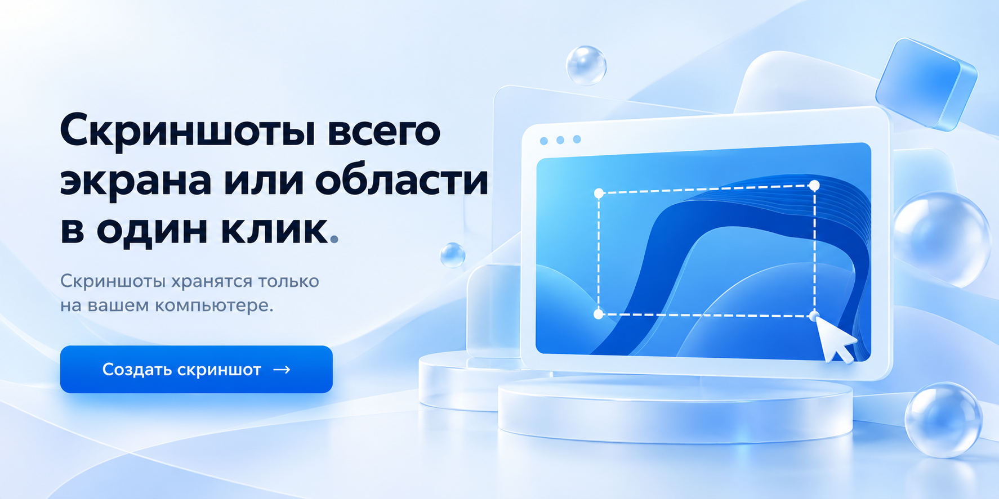

# FastScreen

Скриншоты всего экрана или области в один клик. Сохранение на вашем компьютере, без аккаунтов и отправки снимков на серверы.



**[Скачать для Windows →](https://github.com/zhaunou/FastScreen/releases/latest)** · [История версий](CHANGELOG.md) · [Состояние сборки](https://github.com/zhaunou/FastScreen/actions/workflows/build.yml)

## Быстрый старт

1. Откройте **[последний выпуск](https://github.com/zhaunou/FastScreen/releases/latest)** и в разделе **Assets** скачайте `FastScreen-<версия>-windows.zip`.
2. Полностью распакуйте архив и запустите **FastScreen.exe**. Установка не требуется.
3. Нажмите **Создать скриншот** и выберите весь экран или выделение области. Для области зажмите левую кнопку мыши, выделите нужный участок и отпустите.
4. Готово: снимок автоматически сохранится в PNG. Кнопка **Открыть папку** покажет результат.

**Требования:** Windows 10/11 x64 и .NET Framework 4.8. Python и инструменты разработки не нужны. Архивы **Source code** предназначены для сборки из исходников.

## Что умеет FastScreen

| Возможность | Как работает |
| --- | --- |
| Весь экран | Все подключённые мониторы в одном снимке |
| Выделенная область | Выбор области для скриншота |
| Горячие клавиши | Снимки из других программ, пока FastScreen запущен |
| Работа из трея | Быстрый доступ без открытого основного окна |
| Звуковой отклик | Мягкий сигнал после успешного сохранения |

## Горячие клавиши

| Действие | По умолчанию |
| --- | --- |
| Снять весь экран | **Ctrl + Shift + F** |
| Выделить область | **Ctrl + Shift + A** |
| Отменить выделение | **Esc** или правая кнопка мыши |

Свои сочетания можно назначить в разделе **Горячие клавиши**. Если сочетание уже занято другой программой, выберите другое.

## Где найти скриншоты

Папка по умолчанию для каждого пользователя Windows:

```text
%LOCALAPPDATA%\LocalScreenshot\Screenshots
```

Чтобы выбрать другую локальную папку, нажмите **Изменить…** в интерфейсе. Программа запомнит выбор. Перед захватом окно скрывается; курсор мыши в PNG не включается.

FastScreen сам не загружает снимки в интернет. Если выбранную папку синхронизирует сторонний сервис, например OneDrive, он может загружать её содержимое независимо от FastScreen. Сетевые папки и пути со ссылками не поддерживаются.

## Как свернуть и закрыть

Кнопка **В трей**, сворачивание и крестик скрывают окно. Чтобы вернуть его, дважды нажмите на значок FastScreen в трее. Для полного выхода выберите **Выйти** в меню значка. Повторный запуск программы возвращает уже открытое окно.

## Обратная связь

Ошибки и идеи можно оставить в **[Issues](https://github.com/zhaunou/FastScreen/issues)**. Укажите версию программы, версию Windows и шаги воспроизведения; не прикладывайте личные данные.

Об уязвимостях сообщайте приватно по инструкции в **[SECURITY.md](SECURITY.md)**.

## Для разработчиков

Сборка из исходников, тесты и публикация новых выпусков описаны в **[руководстве по разработке](docs/DEVELOPMENT.md)**. Готовый EXE пока не подписан цифровой подписью; контрольные суммы SHA-256 доступны в каждом выпуске.

## Лицензия

© 2026 **zhaunou** · **[FastScreen Non-Commercial License 1.0](LICENSE)**.

Разрешено личное некоммерческое использование. Коммерческое использование, включая внутренние задачи коммерческих компаний и ИП, продажа копий и платный доступ требуют отдельного письменного разрешения автора. Полные условия — в [LICENSE](LICENSE).
